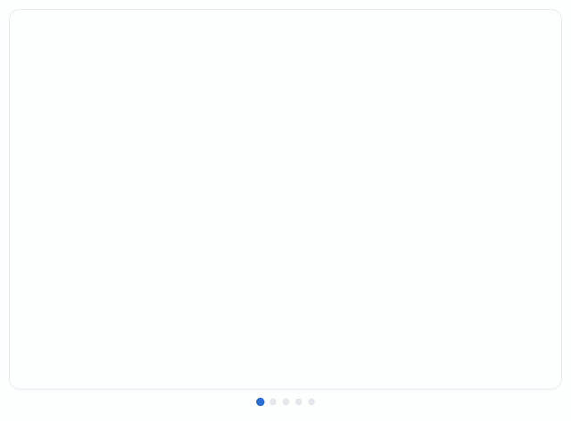
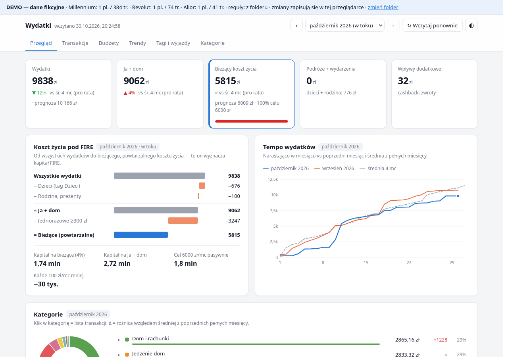

# Wydatki — a dashboard that sends your data to no one

🇵🇱 **[Polska wersja → README.md](README.md)**

**[▶ See the demo](https://wydatki-app.github.io/wydatki/#demo-en)** · **[⬇ Download wydatki.html](https://github.com/wydatki-app/wydatki/releases/latest/download/wydatki.html)** · **[❓ How it works](https://wydatki-app.github.io/wydatki/how-it-works.html)**

[](https://wydatki-app.github.io/wydatki/animacja.html)

*The whole process in 25 seconds (fictional data). Step by step — rule order, living-cost layers, where your changes are saved: [how it works](https://wydatki-app.github.io/wydatki/how-it-works.html).*

You drop in bank statements (OFX/QFX, CSV, PDF or XLSX) and get automatic categories, budgets, trends
and an answer to "how much do I really spend each month" — including the capital you need for FIRE.

The whole app is **one HTML file** that runs in your browser. No installation, no account, no server.



## Getting started (2 minutes)

1. Download [`wydatki.html`](https://github.com/wydatki-app/wydatki/releases/latest/download/wydatki.html) and save it, for example, in a folder named `Wydatki/`.
2. Download your transaction history from your bank into `Wydatki/dane/` (`dane` = data, i.e. your statements):
   ```
   Wydatki/
   ├── wydatki.html
   ├── dane/
   │   ├── ofx/          ← any bank with OFX/QFX export ("Download for Quicken")
   │   ├── millennium/   ← Millenet: transaction history → CSV
   │   ├── velo/         ← account or card history → PDF
   │   ├── revolut/      ← app: CSV statement or Account Statement
   │   ├── alior/        ← card history → CSV
   │   ├── mbank/        ← account history → CSV
   │   ├── pkobp/        ← account history → CSV
   │   └── bnp/          ← GOonline: operations statement → XLSX
   └── ustawienia/       ← your categories, tags and budgets will be saved here (ustawienia = settings)
   ```
   The folder names are literal and stay in Polish. The bank subfolders are optional.
3. Open `wydatki.html` (double-click) → **Choose your Wydatki folder**. To look around first, click **See the demo**.

The bank is detected from the file contents — the subfolders only keep things tidy.

## What it does

| Feature | Description |
|---|---|
| Import | OFX/QFX from any bank (the universal format); also Millennium, VeloBank (PDF), Revolut (2 formats), Alior, mBank, PKO BP, BNP Paribas (XLSX); merges multiple exports and removes duplicates |
| Language and currency | UI in Polish or English (switch on the start screen and in Settings); main currency from settings or the most common one in your files — transactions in other currencies are skipped and reported, with no exchange-rate conversion |
| Banks and cards | spending by bank → card/account (last 4 digits only), change vs. the average; click = transactions from that source; your own card names, e.g. "Son's card" |
| Categories | automatic from rules (`kategorie.yaml`), manual fix in one click, custom categories |
| Tags | "Vacation 2026", "Kids", "Gifts" — the cost of a trip or hobby across categories |
| Budgets | monthly and annual, by category or tag, with exceptions for specific months |
| Cost of living | total → without travel → without kids/family → without one-offs = current cost of living |
| FIRE | cost of living converted to the capital needed at a 4% withdrawal rate |
| Trends | month over month, pace of spending within the month, drill-down to transactions |
| Search | transactions by description, category, tag, and bank or card |

Views in the app: Overview, Transactions, Budgets, Trends, Tags & trips, Settings.

## Security

- Files are read **locally** in the browser — they are never sent anywhere.
- The page has a CSP policy `connect-src 'none'`: **the browser blocks every network connection** from this page.
- Every code change goes through an automated privacy test: CSP without network access, no network functions and no external addresses in the built file.
- Check for yourself: turn off the internet (airplane mode) and load your files — it works the same.
- The browser remembers your settings (categories, tags, budgets, refunds) and the last folder, not whole statements. The settings do contain descriptions of the transactions you corrected (date, description, amount). On a shared computer click **"clear browser data"** (top bar or start screen). The files in your folder stay, and if you have changes without a backup, the app warns you before they are lost.
- Every release is built by GitHub Actions from the code in this repository; a SHA-256 checksum is published next to the file.

Details and how to verify: [BEZPIECZENSTWO.md](BEZPIECZENSTWO.md) (in Polish).

## Browsers

| Browser | Saving changes (categories, tags, budgets) |
|---|---|
| Chrome, Edge | straight to the `Wydatki/` folder (the browser asks for permission) |
| Brave | like Firefox by default (Brave disables writing to folders); writing to the folder works after enabling `brave://flags/#file-system-access-api` |
| Firefox, Safari | in browser storage; **"save settings backup"** creates a file for `ustawienia/` |

## Limitations

- Supported: OFX/QFX from any bank, plus Millennium, VeloBank (PDF), Revolut, Alior, mBank, PKO BP and BNP Paribas (XLSX, first sheet). One main currency at a time (no exchange-rate conversion). Another bank? [Request it](https://github.com/wydatki-app/wydatki/issues/new?template=prosba-o-bank.yml).
- **Saving changes:** Chrome/Edge save categories, tags and budgets straight to the folder. Firefox/Safari keep them in browser storage — use "save settings backup" and move `wydatki-ustawienia.json` into `ustawienia/` (the bar reminds you after 10 changes or 3 days without a backup). Clearing browser data without a backup = losing manual changes; the bank statements are safe.
- Chrome/Edge cannot see files with a colon ":" in the name (e.g. `shared-text-2026-10-01 11:39:03.csv` from a phone) — rename the file.
- A hobby, non-profit project with **no guarantees and no technical support**.

## For developers

Code: plain JavaScript with no libraries and no compile step; `build.py` bundles it into one file.
Structure, building and tests: [ROZWOJ.md](ROZWOJ.md) (in Polish).

License: [MIT](LICENSE).
