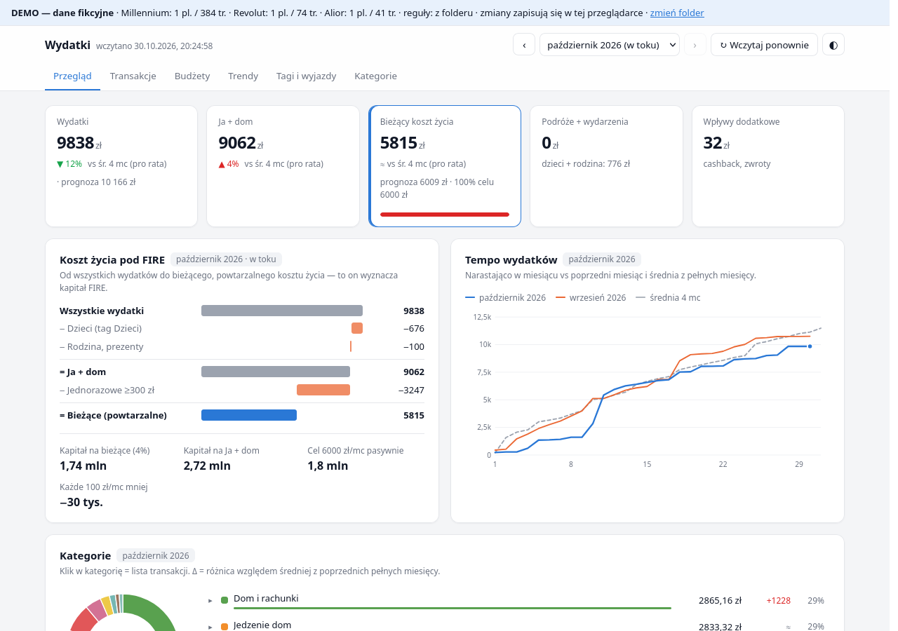

# Wydatki — dashboard, który nie wysyła Twoich danych nikomu

**[▶ Zobacz demo](https://wydatki-app.github.io/wydatki/#demo)** · **[⬇ Pobierz wydatki.html](https://github.com/wydatki-app/wydatki/releases/latest/download/wydatki.html)**

Wrzucasz wyciągi z banku (CSV), dostajesz automatyczne kategorie, budżety, trendy
i odpowiedź na pytanie „ile naprawdę wydaję co miesiąc” — także w przeliczeniu na kapitał potrzebny do FIRE.

Cała aplikacja to **jeden plik HTML**, który działa w Twojej przeglądarce. Bez instalacji, bez konta, bez serwera.



## Jak zacząć (2 minuty)

1. Pobierz [`wydatki.html`](https://github.com/wydatki-app/wydatki/releases/latest/download/wydatki.html) i zapisz go np. w folderze `Wydatki/`.
2. Pobierz historię transakcji z banku (CSV) do `Wydatki/dane/`:
   ```
   Wydatki/
   ├── wydatki.html
   ├── dane/
   │   ├── millennium/   ← Millenet: Historia transakcji → CSV
   │   ├── revolut/      ← aplikacja: wyciąg CSV albo Account Statement
   │   └── alior/        ← historia karty → CSV
   └── ustawienia/       ← tu trafią Twoje kategorie, tagi i budżety
   ```
3. Otwórz `wydatki.html` (dwuklik) → **Wybierz folder Wydatki**.

Bank jest rozpoznawany po treści pliku — podfoldery służą tylko porządkowi.

## Co potrafi

| Funkcja | Opis |
|---|---|
| Import | Millennium, Revolut (2 formaty), Alior; scalanie i usuwanie duplikatów z wielu eksportów |
| Kategorie | automatyczne z reguł (`kategorie.yaml`), ręczna korekta jednym kliknięciem, własne kategorie |
| Tagi | „Wakacje 2026”, „Dzieci”, „Prezenty” — koszt wyjazdu czy hobby w poprzek kategorii |
| Budżety | miesięczne i roczne, po kategoriach lub tagach, z wyjątkami na konkretne miesiące |
| Koszt życia | razem → bez podróży → bez dzieci/rodziny → bez jednorazowych = koszt bieżący |
| FIRE | koszt życia przeliczony na kapitał przy stopie wypłaty 4% |
| Trendy | miesiąc do miesiąca, tempo wydatków w miesiącu, drill-down do transakcji |

## Bezpieczeństwo

- Pliki są czytane **lokalnie** w przeglądarce — nigdzie nie są wysyłane.
- Strona ma politykę CSP `connect-src 'none'`: **przeglądarka blokuje każde połączenie sieciowe** z tej strony.
- Sprawdź sam: wyłącz internet (tryb samolotowy) i wczytaj pliki — działa tak samo.
- Każde wydanie jest budowane przez GitHub Actions z kodu w tym repozytorium; obok pliku jest suma SHA-256.

Szczegóły i jak to zweryfikować: [BEZPIECZENSTWO.md](BEZPIECZENSTWO.md).

## Przeglądarki

| Przeglądarka | Zapis zmian (kategorie, tagi, budżety) |
|---|---|
| Chrome, Edge, Brave | prosto do folderu `Wydatki/` (przeglądarka zapyta o zgodę) |
| Firefox, Safari | w pamięci przeglądarki; **„zapisz kopię ustawień”** tworzy plik do `ustawienia/` |

## Ograniczenia

- Na razie 3 banki. VeloBank (PDF) — w planach. Inny bank? [Zgłoś](https://github.com/wydatki-app/wydatki/issues/new?template=prosba-o-bank.yml).
- Chrome/Edge nie widzą plików z dwukropkiem „:” w nazwie (np. `shared-text-2026-10-01 11:39:03.csv` z telefonu) — zmień nazwę pliku.
- Projekt hobbystyczny, non-profit, **bez gwarancji i bez wsparcia technicznego**.

## Dla programistów

Kod: czysty JavaScript bez bibliotek i bez kroku kompilacji; `build.py` skleja go w jeden plik.
Opis struktury, budowania i testów: [ROZWOJ.md](ROZWOJ.md).

Licencja: [MIT](LICENSE).
